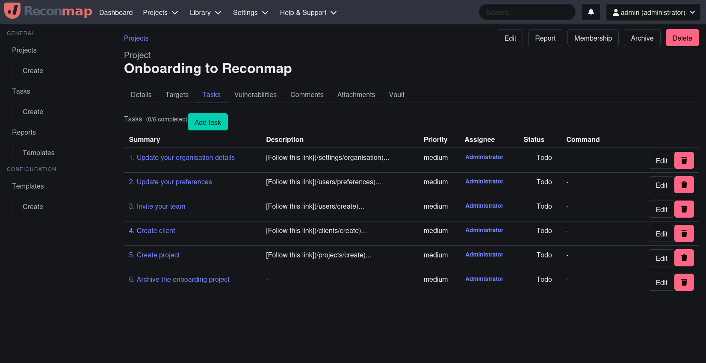

<div style="text-align: center;">

<h1>Reconmap</h1>

[](https://www.youtube.com/reconmap)

<h3>AI-powered finding scanning and reporting for teams running many engagements.</h3>
</div>

Give it a target. Reconmap plans the scan, runs the tools, triages the findings and writes the report. Every engagement lives in one place, so your team spends its time on the work that needs a human.



## What it does

- **Plans scans.** Enter a URL, domain, IP or repo. The AI picks the tools from your command catalog, orders them, and queues the run.
- **Runs them anywhere.** Runners execute commands on your own machines and send the output back.
- **Parses everything.** Built-in parsers for SARIF, CycloneDX, Nmap, Testssl, Subfinder and more. Anything else goes through the LLM parser.
- **Triages automatically.** Every new finding gets a severity check, exploitability, affected surface, next steps and a false-positive assessment.
- **Writes the fix.** Generate remediation steps per finding, or suggest next commands per asset.
- **Reports.** Export to Word, Markdown or HTML.
- **Scales across engagements.** Many projects, many people, SSO through Keycloak.
- **Bring your own model.** Ollama for fully local inference, or Azure OpenAI, OpenRouter and other OpenAI-compatible endpoints.
- **MCP server.** Let your AI assistant query and drive Reconmap.

## Quickstart

You need [Docker](https://docs.docker.com/get-docker/) and [Docker Compose](https://docs.docker.com/compose/install/).

```sh
docker compose up -d
```

Open http://localhost:5500.

Prefer not to install anything? Try the [live demo](https://reconmap.com/overview/live-demo/) or use the hosted version at [netfoe.com](https://www.netfoe.com).

## Under the hood

| Component | Stack | Path |
|---|---|---|
| Dashboard | React | [`src/dashboard`](src/dashboard) |
| API | C# / .NET 10 | [`src/server`](src/server) |
| Runner (`reconmapd`) | Go | [`src/runner`](src/runner) |
| CLI (`rmap`) | Go | [`src/cli`](src/cli) |

PostgreSQL for data, Redis for cache, Keycloak for auth.

## Documentation

User, admin and developer manuals: <https://reconmap.com>. See [AI features](docs/pages/user-manual/system/ai-features.md) for model setup and data handling.

## Contributing

- ⭐ **Star this project on GitHub** to show your support, help others discover it and be notified of new releases.
- Fix or extend the [docs](https://github.com/reconmap/documentation).
- Share your ideas or suggest new features on [Discussions](https://github.com/reconmap/reconmap/discussions).
- Contribute to the project by sending pull requests.
- Report bugs and security issues in [Issues](https://github.com/reconmap/reconmap/issues).

Read the [Contributing Guidelines](https://github.com/reconmap/.github/blob/main/CONTRIBUTING.md) first.

## Sponsors and supporters

<p>
  <a href="https://www.digitalocean.com/" target="_blank">
    
  </a>
  <br/>
  <a href="https://snyk.io/?utm_source=open-source&utm_medium=pg-ptr&utm_campaign=ref-2501-osp&utm_content=pg-cta" target="_blank">
    
  </a>
</p>
