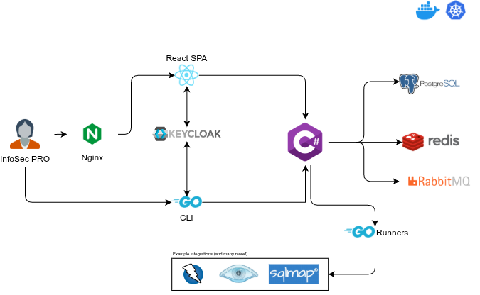

The Reconmap multi-tier architecture was designed to scale and serve anything from small pentesting teams to large infosec organisations. At a high-level it consists of multiple clients (web and command line) that communicate to a Rest API to get and process information. Data is stored permanently in a PostgreSQL database, and a Redis service is used to cache information.

A keycloak identity service (Open ID connect) is used to authenticate users and JWT tokens are also used for service to service communication.

### Authorization & Service Accounts

Centralized authorization is enforced via **Open Policy Agent (OPA)** rules integrated with the C# REST API through `OpaActionFilter`. 

- **Regular Users:** Authenticated users are resolved to database records in the `user` table by their Keycloak subject id. The table holds Reconmap's own data (role, short bio, preferences). Identity fields such as username, email, names, locale, timezone and MFA status live in Keycloak; the API merges them into responses and writes changes to whichever system owns them. Their roles and permissions are queried to validate requests.
- **Service Accounts (Runners):** Reconmap runner clients (`reconmapd`) authenticate via OAuth Client Credentials grant. Because they are machine accounts and do not exist in the database `user` table, the API bypasses the database user lookup during authorization check and maps them to a virtual Administrator user. This ensures runners can successfully execute their boot, ping, and check-in endpoints. The virtual user is never persisted, so records they create, and audit entries written by the system itself, have a `NULL` `created_by_id`.

### Tenant data access

OPA grants only explicitly named endpoint capabilities; it never treats a missing `project_id` as authorization. Collection and indirect-resource endpoints additionally use the API's request access scope, which resolves the caller's project memberships and applies them to every database query.

- Users and clients can access project data only in projects where they are members.
- Users can access vault secrets they own or secrets associated with one of their projects. Clients cannot access the vault.
- Notifications are visible and mutable only by their recipient.
- Attachments and comments must resolve through a project, task, vulnerability, or non-template report in a member project. Unscoped attachment parents are administrator-only.
- Jira/Azure DevOps integration configuration and system data import/export are administrator-only. Integration API tokens and personal access tokens are never included in API responses.

### Identifiers

Entities that are exposed by id in URLs, API responses and the dashboard use UUIDs instead of sequential integers, so ids cannot be guessed or counted. The UUID version depends on whether the creation time may be derived from the id:

| Entity | Id | Why |
|---|---|---|
| Projects, tasks, reports | UUIDv7 | Time-ordered, so inserts stay index-friendly and the id sorts by creation time. The creation time is not sensitive. |
| Vulnerabilities | UUIDv4 | Random, so the id does not reveal when a finding was reported. Order lists by `created_at` (the `vulnerability_created_at_idx` index covers it, with the id as tie-breaker). |

All other entities (users, organisations, assets, attachments, comments, notifications, runners and so on) keep serial integer ids. The `comment` and `attachment` tables point at their parent with a `parent_type` and a `parent_id`; the parents that exist today (projects, tasks, vulnerabilities and reports) all have UUID ids.

The API generates the ids (`GuidV7ValueGenerator` and `GuidV4ValueGenerator` in `Infrastructure/Persistence`), and the database has matching defaults (`uuidv7()` and `gen_random_uuid()`) for rows inserted with SQL, such as the seed data. Routes use the `{id:guid}` constraint, so a malformed id returns `404 Not Found`. UUIDs are not a substitute for authorization: every request is still checked against OPA and the caller's project memberships.

The last part of this architecture is Rabbitmq, a message queue and broker. This queue handles heavy or asynchronous background tasks like sending report emails and generating reports asynchronously.

_The diagram above was created from code using [draw.io](https://www.drawio.com/). See the source [here](https://github.com/reconmap/reconmap/blob/main/docs/diagrams/reconmap-high-level-architecture.drawio)._
