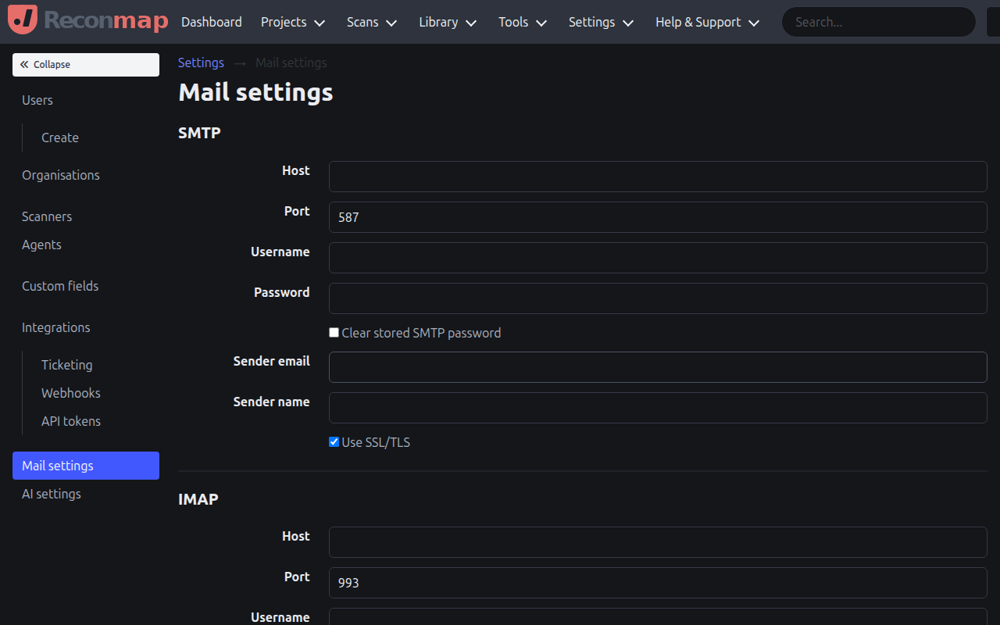
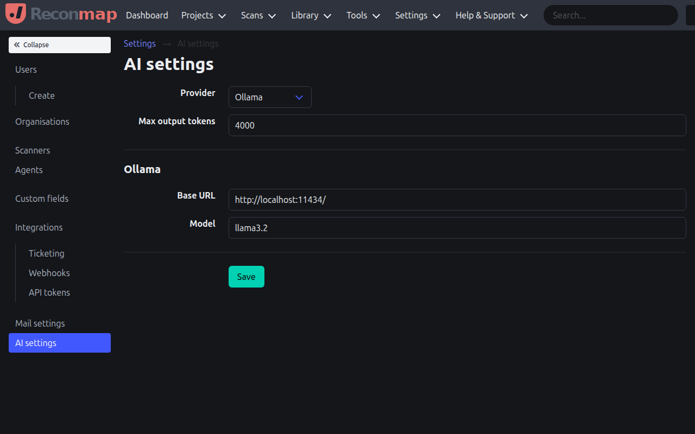

The **system settings** view allows administrators to configure the Reconmap application.

## Mail Settings

The **mail settings** view allows you to configure the SMTP server used for sending emails (notifications, reports, etc.).

You can specify:

- SMTP server address and port.
- Authentication credentials (username and password).
- Encryption type (SSL/TLS).
- Sender name and email.

## AI Settings

The **AI settings** view allows you to configure the AI features in Reconmap, such as finding summary and remediation advice generation.

You can specify:

- **AI Provider**: Select between Ollama (for self-hosted local models), Azure OpenAI, OpenRouter, AnonRouter, Cheaper Inference, or cheapaimodel.
- **Provider Settings**:
  - **Ollama**: Configure the Ollama base URL and Model name (e.g. `llama3.2`).
  - **Azure OpenAI**: Configure the endpoint URL, API key, and model deployment name.
  - **OpenRouter**: Configure the API key and preferred model name (e.g. `meta-llama/llama-3.1-70b-instruct`).
  - **AnonRouter**: Configure the API key and model name. Both are required; there is no default model. Enter the model identifier exactly as the provider lists it — identifiers are case-sensitive and may contain a `provider/model` prefix.
  - **Cheaper Inference**: Configure the API key and model name (e.g. `gpt-5.4-mini`). Model identifiers are bare, without a `provider/` prefix (e.g. `claude-sonnet-5`, `deepseek-v4-flash`).
  - **cheapaimodel**: Configure the API key and model name (e.g. `deepseek-v4-1-flash`). Model identifiers are bare, without a `provider/` prefix (e.g. `glm-5.3`, `kimi-k3`).
- **Max output tokens**: Control the maximum response length.

The provider selector and its fields are generated from the API's
`ai-providers.json` catalog. API keys are encrypted before storage and are
never returned to the browser; leaving a populated key field blank preserves
the stored value.

These AI features help you speed up the reporting process by automatically generating descriptions and advice for reported findings.
